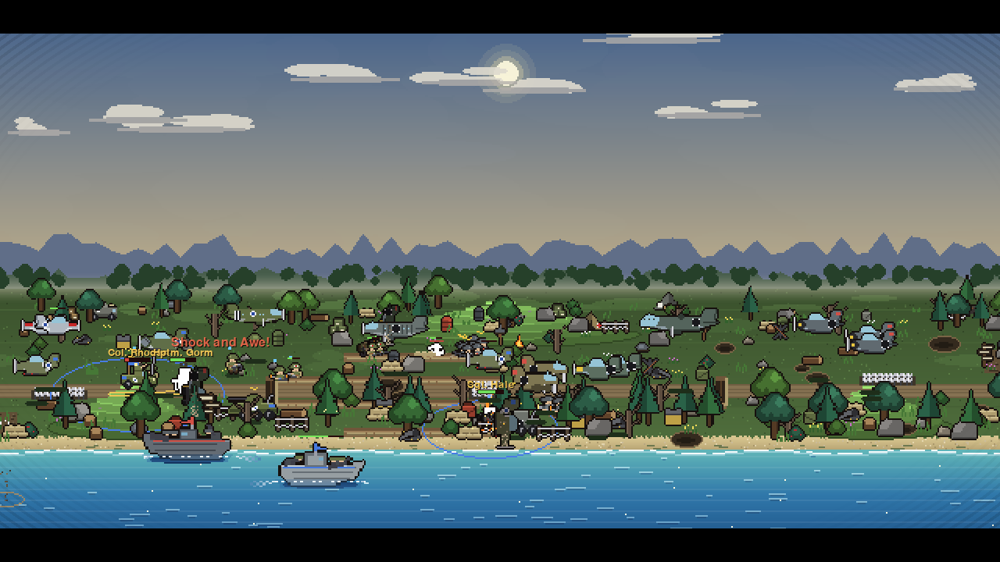
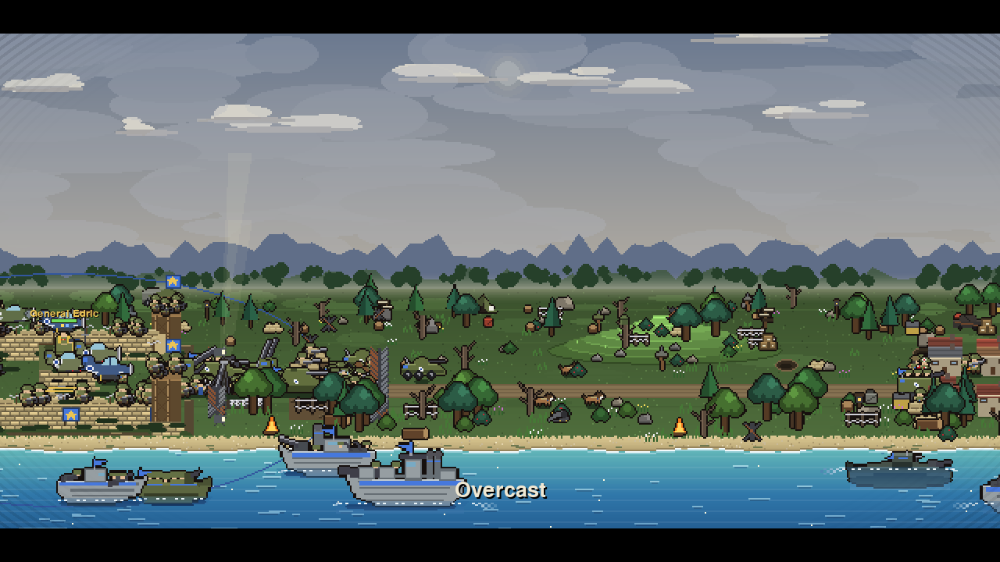
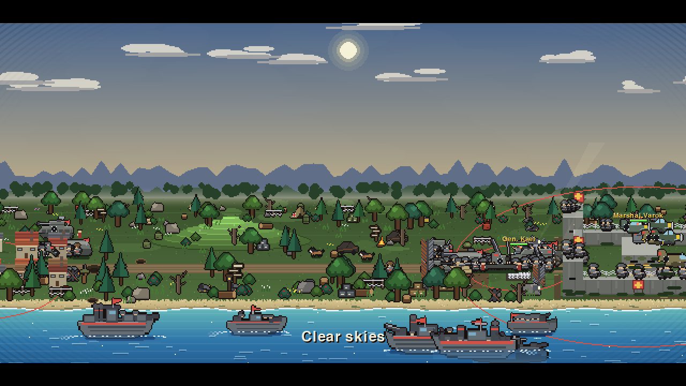
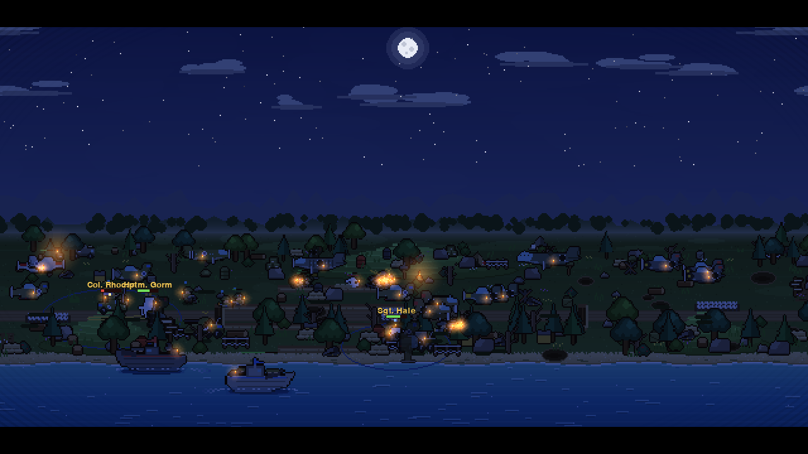
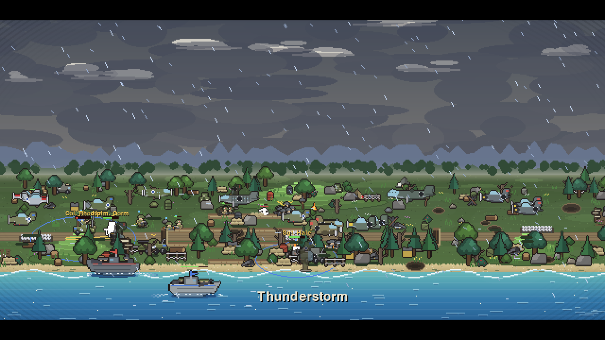
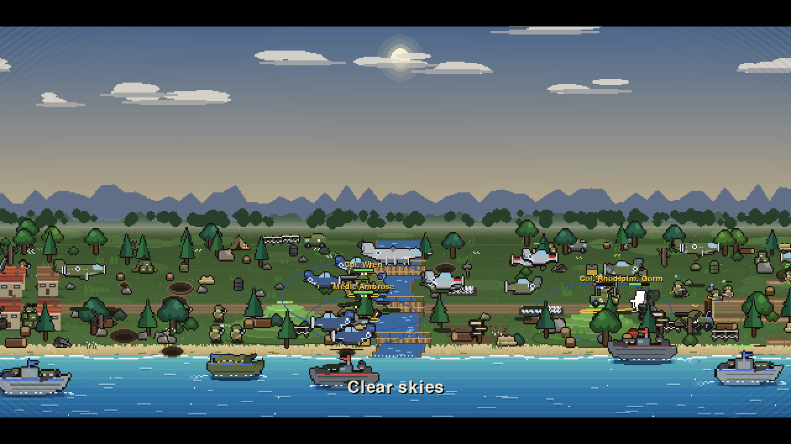
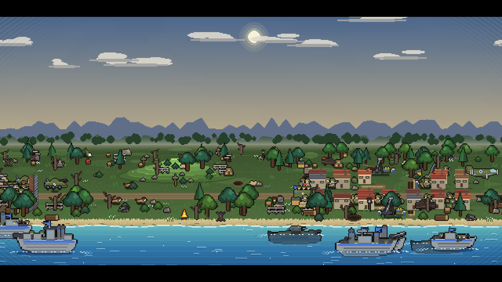

# Pixel BS: WW2



<table>
  <tr>
    <td></td>
    <td></td>
  </tr>
  <tr>
    <td></td>
    <td></td>
  </tr>
  <tr>
    <td></td>
    <td></td>
  </tr>
</table>

*Day, night and weather over the same war. These are real frames from the game; `python docs/capture.py` regenerates
them.*

A World War II battle simulator in pygame-ce. Two fortified camps face each other across a valley: the **Allied Forces**
(blue marking, left) and the **Axis Forces** (red marking, right). Each camp has sandbag and concrete walls, corner
bunkers with sentries, a checkpoint barrier, an anti-tank ditch and a command post with its general. Along the bottom of
the map lies a beach and a sea, where gunboats fight and land marines. Nothing ends: the fighting goes on for as long as
the program runs, with both sides sending in reinforcements as they lose men. It is built as a pastime or wallpaper: no
timer, no end, no input needed.

The view is a side-on 2.5D one. The battlefield's depth becomes lanes: the far edge is small and high on screen, the
near edge large and low. The field is 6000 pixels wide (the window shows 1280) and a camera scrolls over it, following
the fighting on its own; the arrow keys pan it by hand. A day and night cycle (five real minutes) tints the scene; at
night the men carry torches and the camps glow. Weather comes and goes and changes how the fighting goes. Everything is
drawn at low resolution (640x360) and scaled up, so it has a pixel-art feel. The program starts fullscreen with cinematic
bars and no HUD.

## What is on the field

**Infantry and vehicles** (`scenarios/camp_war.json`):

| Unit | Role |
| --- | --- |
| rifleman | the line infantry (GI rifleman / Grenadier) |
| machine gunner | shoots bursts into packed crowds (MG team on the Axis side) |
| flamethrower | sets its target alight |
| scout car | fast and mounted: charges in pairs hit foot soldiers hard (Jeep / Sidecar motorcycle) |
| sniper | long-reach, fragile |
| bazooka team | hits vehicles 1.8 times as hard |
| assault trooper | fast and fragile, hits harder the more hurt it is |
| anti-tank rifleman | a heavy rifle behind a shield: its rounds pierce a dug-in position |
| war dog | very fast, and hunts routing men |
| marine | lands from the boats (Marine / Naval infantry) |
| sentry | a garrison rifleman that stands on bunkers and walls |
| engineer | clears mines, cuts wire, and blows breaches in walls with satchel charges (Combat engineer / Pionier) |
| medic | heals the wounded around it (Combat medic / Sanitäter) |
| commando | fast, deadly infantry that slips through; hits hard at close range (Ranger / Brandenburger) |
| flame squad | two flamethrowers working as a pair |
| HMG nest | a fixed heavy machine gun with a long reach (Browning nest / MG42 nest) |
| paratrooper | drops from a transport behind the enemy, helpless until it lands (Airborne / Fallschirmjäger) |
| armoured car | fast, light vehicle: hunts men and runs down wire (Greyhound / Puma) |
| tank destroyer | a long-range gun that hits vehicles hard (Wolverine / Jagdpanzer) |

**Heavy weapons** (they roll up with the army and batter walls, gates, bunkers and barricades):

| Weapon | Role |
| --- | --- |
| field gun | shells with splash, sometimes incendiary (Rocket launcher on the Axis side) |
| howitzer | a high lob with a long reach and a big blast |
| mortar | a lighter piece that always fires incendiary rounds |
| tank | hits structures only, never men |
| flak gun | shoots only at the sky: a heavy round that ignores the flyer dodge |
| halftrack | slow and tough, with a squad inside (Armoured halftrack on the Axis side) |

**Aircraft**: dive bombers (Dauntless / Stuka) bomb the ground; fighters (Mustang / Messerschmitt) hunt other aircraft;
heavy fighters (Thunderbolt / Focke-Wulf) are the heavy air fighters; strafers (Typhoon / Henschel) rake men rather than
bombing. Transport planes drop supply crates or paratroopers; heavy bombers (Fortress / Heinkel) fly a long carpet-bombing
run. See *Flyers* below.

**Ships**: torpedo boat (PT boat / E-boat), gunboat, cruiser (Monitor / Rocket ship), destroyer (Fletcher / Z-class; it
hunts submarines and shoots at aircraft), submarine (Gato / U-boat; it stays under the surface and fires torpedoes) and
landing craft (Higgins boat / Landing barge). See *The sea* below.

## Field extras

All of these are driven by unit flags and terrain styles in the scenario file (`extras.py` is the engine side):

- **Minefields** (terrain style `mines`, with an `owner`): hidden mines blast enemy men (vehicles take 2.6 times the
  damage). Engineers (`sapper`) clear them.
- **Barbed wire** (style `wire`): slows men on foot. Vehicles and engineers cut through it.
- **Fortifications**: the `fortify_*` events add sandbags, wire and hedgehogs to the camps as the battle wears on.
- **Smoke screens**: units with `smoke_ammo` (the mortars) sometimes fire smoke; whoever stands in the cloud cannot be
  seen from a distance.
- **Supply drops**: a transport plane (`cargo: "crate"`) drops a crate on its own army: the first man to reach it is
  healed and steadied.
- **Paratroopers**: a transport with any other `cargo` value drops `cargo_n` of its `cargo_unit` over the enemy army.
- **Medics** (`heal`, `heal_radius`): heal the three most hurt friends nearby.
- **Searchlights**: the scenario's `searchlights` list (`side`, `x`, `y`, `range`); enemy aircraft caught in a beam cannot
  dodge ground fire, and the beams are drawn at night.
- **Veterancy**: a unit with 2, 5 and 10 kills rises in rank (chevrons over its head), is healed, and hits 12%, 25% and
  40% harder (`VET_*` in `config.py`).
- **Rounds**: each unit type's `round` picks the art and its `angle` / `flight_k` the arc: a sniper's thin blue streak,
  red machine-gun tracers (HMG nests, armoured cars), a flame jet, rockets on a smoke trail (the Axis rocket launcher, the
  rocket ship's salvo), a flat fast armour-piercing round (tank destroyers), a heavy dark howitzer shell on a steep lob, a
  finned mortar bomb dropping nose down, and flak that ends in a black burst. Heavy bombers drop larger bombs.
- **Barrages** (the `barrage` event action: `side`, `style`, `area`, `radius`, `damage`, `count`): every third 20-second wave (the `wave_clock` event)
  the Allied castle fires a **missile barrage** (`"missiles"`: 16 small rockets that leave one after another and come
  down all over the middle of the field, each with a small blast), and the Axis castle launches a **V-2** (`"v2"`: one
  huge black-and-white rocket, a pulsing red ring on the target, and one enormous blast over a single area).
- **Weather-driven aircraft**: `fair_weather` aircraft (bombers, transports) abort and fly home in heavy rain, storm or
  fog; `storm_grounded` ones (the fighters) in a storm.

**Heroes and generals**: four named heroes per side plus a general in each command post. See *Heroes*.

## Heavy weapons

Four big units, one pair for each side, fielded from the start (`camp_war.json`) and written into a scenario like any other
unit type:

- **MLRS pod** (Allies, `sprite: "mlrs"`, `"salvo": 10`): a rocket-lorry siege unit. Each shot looses `salvo` small rockets
  (the castle barrage's missile art) that scatter over a patch (`"spread"`) round the target, each one a small blast.
- **V-2 launcher** (Axis, `sprite: "v2_launcher"`, `"v2": true`): a trailer with a raised black-and-white V-2. It fires one
  huge rocket that climbs out of the sky and drops on its target in a single big blast (`splash`), slowly (18 s reload).
- **Aircraft carrier** (Allies, `naval_role: "carrier"`): steams back and forth over its own waters and keeps a wing aloft:
  every `sortie_every` seconds it flies off up to `sortie` aircraft (alternating the `wing` types, here the Avenger bomber
  and the Hellcat fighter) until `hangar` are airborne, replacing losses. The aircraft are ordinary flyers that bomb or
  strafe men, guns and ships and fight other aircraft, and its deck guns shoot at the foe near it. The aircraft parked on the
  deck in its sprite are those still in the hangar.
- **Dreadnought** (Axis, `naval_role: "bombard"`, `"volley_targets": 4`): a battleship with a long reach whose broadside
  picks up to `volley_targets` different marks (men on the shore, ships, and aircraft too since it has `"aa"`), so one salvo
  falls on four places at once.

## The land

The field is 6000 pixels wide and has a middle part with land of its own:

- **Two rivers** (the Marne and the Oder) run from the far edge to the sea and block every unit on foot or on wheels.
  Each has three **bridges** (the road bridge, a northern and a southern one), so an army funnels into the crossings and
  the fighting piles up at the banks. Aircraft and ships are not held up.
- **Bridges can be destroyed.** Shells, bombs, missiles and the V-2 that land on a bridge hurt it; siege engines and
  engineers also blow up a bridge that foes are crossing. When it falls the river closes and anyone on it drowns.
- **Only engineers mend them.** An idle engineer within 650 pixels walks to the nearest fallen bridge and rebuilds it
  (14 engineer-seconds; it comes back at 70% strength).
- **Pontoons.** An engineer held up at a river with friends behind him and no bridge nearby floats a **pontoon** across
  (8 engineer-seconds). It has only 45 hit points: a shell sinks it, a tank crossing it nearly does.
- **Hills** give a man on them 15% less damage taken and 15% more reach, but slow him by 15%.
- **Towns** (Ashford for the Allies, Brandt for the Axis): rows of solid houses with streets between them that slow an
  advance and can be shelled to rubble.

## Waves and sorties

- **Musters**: every 20 s both sides get a mix of every infantry and vehicle type in their camp, while each side has
  fewer than 190 units. Each firing is a **wave**.
- **Siege waves**: every fourth 20-second wave, each side gets a field gun, howitzer, mortar, flak gun and tank (the
  `siege_wave` event, which uses the `wave` condition). Field guns, mortars and flak guns also arrive on timers (from
  40 s), and howitzers from 150 s.
- **Sorties**: when 6 enemies gather in front of a gate, or 10 of a side's men are in its courtyard, the barrier lifts and
  a sortie goes out. Every sortie carries every land unit type. The barrier drops again 20 s later.
- **Assaults**: once 25 of a side's units are in the middle, or after 150 s, that side's goal changes to the enemy command post
  and it marches on it. This fires once per battle.
- **Air waves** every 40 s (bombers, fighters, heavy fighters, strafers, up to each type's `max_alive`) and **sea waves** every
  55 s (ships).

## The sea

The map's `"shore"` is the y where the beach gives way to water; everything from there down is a sea lane. Land troops
cannot enter the water and ships cannot leave it (`naval.py`).

| Ship | What it does |
| --- | --- |
| torpedo boat | a fast raider that rams other ships |
| gunboat | machine guns on a broad deck: shoots ships and men on the beach |
| cruiser | shells ships and the shore, with splash |
| landing craft | carries 6 marines to the enemy's beach, puts them ashore, goes home and reloads (50 s) |

Ships steer like flyers: they turn slowly, sweep in curves, circle their prey and keep station at the range of their
weapons. With nothing to fight they patrol from their own end of the sea to the enemy's and back. Riflemen, heavy
weapons, heroes and aircraft carrying fire can hit ships; melee troops cannot. Ships bob on the swell, leave a wake, burn
when hit and sink with a splash, leaving floating wreckage. Shots that miss throw up water.

## Weather

`weather.py` runs the weather in the simulation: clear, cloudy, rain, storm, fog and snow, changing every 60 to 130
seconds. The scenario's `"weather"` block sets the `start`, the `cycle` and the `weights`; W steps to the next kind.
Numbers ease from one state to the next over 14 s, so a front rolls in.

| Weather | Effect |
| --- | --- |
| rain | men walk slower, incendiary rounds mostly fail, burning men go out, shells fly a little short |
| storm | all of that, plus wind that slows aircraft, a rough sea that slows ships, and lightning that hurts and ignites |
| fog | men see less far |
| snow | men walk slower and see less far, and snow settles on the field |

It draws as grey and darkened skies, drifting cloud decks, rain with splashes, snow, banks of mist, lightning flashes
and thunder that arrives after them. Weather has its own random generator, so it never disturbs the fighting's dice.

## Heroes

Each camp has four named heroes of different kinds. Each has two **passive** skills (always on) and two **active**
skills (cast on their own judgement, then on cooldown). A hero who falls returns `respawn` seconds later (30). Heroes
never rout, rally the men near them, and a badly wounded melee hero pulls back to recover. Each shows a name, a health
bar and two lamps (lit when an active skill is ready); a faint ring on the ground shows the reach of an aura, and the
skill's name floats up when it is cast. Skills are listed in `heroes.py`; a hero is a unit type with `"hero": true` and
a `"skills"` list of four ids (two passive, two active), placed with a named group of one.

| Hero | Kind | Passive | Active |
| --- | --- | --- | --- |
| Sgt. Hale (Allies) | infantry sergeant | Body Armor, Return Fire | Dig In, Concussion Grenade |
| Col. Rhodes | mounted commander | Command Flag, Officer Presence | Armoured Charge, Rally Whistle |
| Cpl. Wren | marksman | Scope, Headshot | Suppressing Fire, Armor-Piercing Round |
| Medic Ambrose | field medic | Field Hospital, Combat Medic | First Aid, Air Strike |
| Hptm. Gorm (Axis) | assault captain | Adrenaline, Combat Rage | Grenade Spray, Shock and Awe |
| Gen. Kael | mounted commander | Full Throttle, Panzer Group | Blitz Charge, Armoured Rally |
| Jager Sable | flame ranger | Incendiary Rounds, Rangefinder | Napalm, Leg Shot |
| Dr. Morwen | artillery officer | Artillery Doctrine, Spoils of War | Marked for Death, Rocket Barrage |

Each side's **general** stands in his command post (General Edric, Marshal Varok): a hero who cannot leave it, shoots foes
within 220, and has two auras and two commands that reach across the field (Command Umbrella, Supply Line / General
Offensive, Hold the Line for the Allies; Iron Discipline, Blitz Doctrine / Forced March, Barrage for the Axis). He
returns 60 s after falling.

## Two sides, two looks

Each side has a `"style"` and its own versions of the common troops, aircraft, ships and heavy weapons: a unit type with
`"side"` and `"replaces"` takes the place of that unit whenever the side spawns it. The art lives in `ww2_art.py`
(soldiers and heroes), `ww2_vehicles.py` (cars, halftracks, tanks, guns) and `ww2_air_sea.py` (aircraft and ships).

| | Allies | Axis |
| --- | --- | --- |
| camps | olive sandbags and concrete, star emblems, blue pennants | grey concrete, plain-cross emblems, red pennants |
| men | olive-drab uniforms, M1 helmets, blue armband | field-grey uniforms, stahlhelms, red armband |
| aircraft | olive and blue, white stars | grey and red, black crosses |
| ships | grey hulls, blue markings | dark hulls, red markings |
| vehicles | Jeep, tanks in olive | sidecar bikes, armoured halftracks, rocket launchers |

The heavy weapons are drawn large, about twice the height of a soldier.

## Halftracks

A halftrack (Allies) or armoured halftrack (Axis) is a slow, tough vehicle with a squad inside (`"tower": true`,
`"garrison"`, `"shoot_height"`). It fires bursts from the top and its slits, more while it is full; its crew die with it
as it takes damage, and when it is destroyed the survivors tumble out as machine gunners.

## Flyers

Aircraft ignore walls, ditches and trenches and are out of reach of melee men, heavy weapons and splash. Riflemen, the
generals, flak guns and the ranged heroes can shoot them down, though a share of the rounds miss (`AIR_DODGE`). A flyer
steers rather than walks, so it makes curving bombing runs past its target and circles back; fighters wheel
round each other in dogfights. A shot-down aircraft does not vanish: it keeps its heading, spins nose-down trailing flame and smoke, and hits the ground
about a second later (`CRASH_FALL`, `CRASH_DRIFT`). The crash is a blast the size of the aircraft (`CRASH_RADIUS_BASE` plus up
to 28 for a big one) that hurts everyone beneath it, friend or foe, for a share of its hit points (`CRASH_DMG_K`, capped by
`CRASH_DMG_MAX`), falling off toward the edge; men in the middle of the fireball are set alight, and a bridge or house under it
is damaged. It leaves a crater, grass fires and a charred wreck that burns, then smokes, then fades (`WRECK_SECONDS`); an
aircraft that comes down in the sea makes only a splash (and damages any ship it lands on). Storms slow aircraft and push them with the
wind. In a scenario a flyer is a unit type with `"flying": true`, an `"air_role"` (`"ground"` or `"air"`) and an
`"altitude"`. A ground flyer with `"swoop": true` (the strafer) rakes men instead of bombing.

## Sound, shots and camera

- **Sound** (`sound.py`) is synthesized with numpy at start-up, so there are no audio files: a slow march loops under a
  faint wind, with effects for rifle cracks, flamethrowers, machine-gun bursts, mortar salvos, field-gun and howitzer
  blasts, shell bursts, bayonet and rifle-butt clashes, checkpoint barriers, bugle calls, engines, splashes, thunder, and
  loops of rain, surf and gale wind that follow the weather. Effects are panned and fade with distance. Volumes and mute
  are saved in `audio_settings.json`. Put your own `.ogg`/`.mp3`/`.wav` in a `music/` folder to play it instead of the
  march. With no audio device the game runs silent.
- **Shots** all fly real arcs from the shooter to where they land. Flight time follows the battle speed. Rifles and
  machine guns fire tracers, mortars drop bombs, guns and ships fire shells with a brass base, and bombers drop finned
  bombs. A shell throws up dirt, smoke, debris and a shock ring; incendiary rounds burst into flame and leave a fire. At
  sea a miss throws up a splash and a hit throws wood.
- **Camera** glides on a damped spring chasing a smoothed point (`CAM_SMOOTH_TIME`, `CAM_MAX_SPEED`, `CAM_AIM_SMOOTH`
  in `config.py`); arrow-key panning eases in and out.

## Running it

Requires Python 3, pygame-ce (built against 2.5.7), numpy and scipy:

```bash
pip install pygame-ce==2.5.7 numpy scipy
python main.py                          # the camp war
python main.py scenarios/other.json     # any other scenario file
```

| Key | Does |
| --- | --- |
| SPACE | pause / resume |
| + / - | faster / slower (1x, 4x, 16x, 64x) |
| LEFT / RIGHT | pan the camera (it goes back to following the fighting after 8 seconds) |
| C | turn the following camera on or off |
| X | turn the parallax (layers scrolling at different speeds) on or off |
| W | step to the next weather (clear, cloudy, rain, storm, fog, snow) |
| M | mute / unmute all sound |
| [ / ] | music volume down / up |
| , / . | effects volume down / up |
| H | show or hide the HUD (hidden by default; it shows the weather too) |
| L | show or hide the cinematic bars |
| F11 | fullscreen on or off |
| R | start a fresh battle now (with a new seed) |
| ESC | quit |

## Headless check

```bash
python check.py                       # runs seeds 1 and 2 for 600 battle seconds each and prints each one
python check.py --seeds 1,5,9         # other seeds
python check.py --frame camp.png    # also save a frame of the first battle to a PNG
python check.py --frame f.png --cam 3300 --phase 0.0   # ...with the camera at world x 3300, at night
```

`check.py` sets SDL to its dummy video and audio drivers, so no window opens. It checks that a broken scenario is
rejected with a readable message; runs each seed for 600 battle seconds; checks the rules (both sides muster, troops keep
fighting, a barrier sallies, ambushes spring, heroes cast every skill and return after falling, aircraft bomb, dogfight, fall
and strafe, flak guns fire, the garrison shoots from the walls, ships fight and land marines, the weather
changes; medics heal, mines go off, a river blocks and a bridge falls and is rebuilt, crates land, paratroopers jump, smoke falls, men earn ranks); draws dusk, night and dawn frames; and times frames at 4x speed against the 30 fps budget. It exits with
status 1 if a check fails.

## Files

| File | What it is |
| --- | --- |
| `main.py` | the window and the controls: one battle that runs on, and R to start a fresh one |
| `battle.py` | the battle engine: movement, fighting, morale, projectiles, events, objectives (no pygame in it) |
| `air.py`, `heroes.py` | flyers and hero skills (mixins for the engine) |
| `naval.py`, `weather.py`, `extras.py` | ships, weather, and the field extras (medics, mines, wire, smoke, supply, veterancy) (mixins for the engine) |
| `scenario.py` | loads a scenario JSON file and checks it |
| `render.py` | the side-on 2.5D drawing: camera, day and night, lights, units, shots, HUD |
| `render_rounds.py` | the art of each round, and the missile salvo and V-2 (a mixin) |
| `render_land.py` | rivers, bridges and pontoons, hills and houses (a mixin) |
| `ww2_big.py` | art for the MLRS pod, V-2 launcher, carrier and dreadnought |
| `render_crash.py` | falling aircraft, the crash and the wreckage (a mixin) |
| `render_sea.py`, `render_weather.py` | drawing the sea and ships, and the sky, rain, snow, fog and lightning (mixins) |
| `ww2_art.py`, `ww2_vehicles.py`, `ww2_air_sea.py`, `ww2_extra.py` | the WW2 art: soldiers and heroes, vehicles and guns, aircraft and ships, and the later additions (engineer, medic, paratrooper, destroyer...) |
| `render_camp.py` | drawing the camps: sandbag and concrete walls, bunkers, barriers, command posts (a mixin) |
| `sprites.py` | the unit art entry point (re-exports the WW2 art modules) |
| `doodads.py`, `scenery.py` | scenery props, and where they go and which can hide a man |
| `sound.py` | the synthesized music, effects and weather loops |
| `config.py` | how the engine behaves (speeds, morale rules, sea and weather numbers, the look) |
| `scenarios/camp_war.json` | the Allied Forces against the Axis Forces |
| `check.py` | the headless check |

## How a battle works

Time runs in ticks: 2 per second of battle time at 1x (`SIM_RATE`). Each tick:

- Every unit with no target within sight walks toward its side's **goal** (at first the middle of the valley). Each
  side has a flow field, so units go round walls when the way round is short and otherwise press up against them.
  Land units are kept off the beach's edge and out of the water.
- A unit that sees an enemy walks straight at it if nothing solid is in the way, and attacks once the enemy is within
  its **reach**. Each hit does `attack` scaled by a random 0.6 to 1.4, reduced by the target's `defence`. Melee hits
  land at once.
- **Projectiles**: gunners, heavy weapons and ships loose a projectile that hurts its target when it lands, after
  `ARROW_SIM_TIME` (0.5 s) or `STONE_SIM_TIME` (1.0 s) of battle time. If the shooter or the target has died by then,
  it fizzles. Each flies at its unit type's `angle` in degrees (45 by default; the howitzer uses 75, a high lob).
- **Morale**: damage lowers morale; when a unit dies, friends within 90 pixels lose some and enemies gain a little. A
  unit whose morale drops below its `rout_at` routs, running away at 1.5 times its speed until it leaves the map or 30 s
  pass.
- **Heavy weapons** (`"siege": true`) batter the nearest enemy wall, barrier, bunker or barricade when no enemy unit is in
  sight. Each hit takes its `attack` off the structure's `hp`, and a structure at 0 hp is breached. `"splash"` also
  hurts men near the target. A `"struct_only"` unit (the tank) hits structures and never men.
- **Garrisons** (`"speed": 0`) stand on top of walls and towers at that height and shoot over them; if the block is
  breached they fall.
- **Anti-tank ditches** are solid water-filled cuts; the gap in each camp's ditch is the crossing.
- **Lanes**: each mobile unit keeps to one of four lanes, spread across the field and narrowing to the gate lanes before
  a barrier, so a sortie comes out spread across it.
- **Tactics**:
  - *Gunners kite*: a gunner closer than 45% of its reach to a foe steps back instead of shooting.
  - *Focus*: a unit attacks the nearby enemy that is near and hurt, so blows finish men off.
  - *Withdrawal*: a melee unit below morale 40 with more foes than friends nearby falls back.
  - *Dig in*: foot soldiers with 4 or more enemy gunners within 150 and no foe in their face drop behind sandbags and
    take 30% of ranged damage but move at half speed. Anti-tank rifle rounds pierce it (`"pierce_shield"`).
  - *Vehicle charge*: mounted units with two or more mounted friends beside them charge together and hit foot
    soldiers 1.6 times as hard. `"anti_mounted"` units (bazooka teams) hit vehicles 1.8 times as hard.
  - *Berserk*: a `"berserk"` unit hits harder the more hurt it is (up to `BERSERK_SCALE`).
  - *Barrages*: gunners with `"volley": true` loose a barrage when 5 or more enemies are packed within 35 pixels.
  - *Incendiary rounds*: `"fire": true` units set their target alight for 4 s (4 damage a second). Rain mostly stops this.
  - *Spikes*: terrain with `"style": "spikes"` wounds anyone on the ground in it.
  - *Hunting*: `"hunts_routers"` units (war dogs) chase men who are running away.
- **Trenches and craters** are cover: a man in one takes 45% of ranged damage, and gunners step into cover between shots.
- **Ambushes**: every 8 seconds each side looks at where the enemy army is heading and, if a tree, bush, boulder,
  haystack, wagon or tent lies ahead (out of sight), hides a squad of up to 8 non-mounted men there. A hidden man cannot
  be seen or targeted. When a foe comes within 70 pixels the squad springs and strikes 1.6 times as hard for 6 s.
- **Positional play**: a melee blow from behind does 1.4 times the damage, and cavalry ride round a foot foe to strike
  from behind.

Nothing in the camp war has a time limit, timeout or victory condition; a command post can be reached, but nothing is decided
by it. A scenario may leave `time_limit`, `timeout` and `victory` out entirely.

## Writing a scenario

A scenario is one JSON file. The engine loads any file in this shape without code changes; `scenario.py` checks it and
reports the first problem it finds, naming the part that is wrong.

```jsonc
{
  "name": "Camp War",
  "seed": 1,                               // the first battle's seed; each later battle uses seed + 1, 2, ...
  "map": {"width": 6000, "height": 900,    // the map size in world pixels
          "shore": 620},                   // optional: every y from here down is sea (ships need it)

  "sides": {                               // one entry per side; the key is the side's id
    "allies": {"name": "Allied Forces", "color": [70, 120, 220], "goal": [640, 360]}
    // "enemies": ["axis"] can be added; left out means every other side is an enemy
  },

  "unit_types": {                          // one entry per kind of unit
    "rifleman": {
      "name": "Rifleman",                  // shown on screen
      "sprite": "foot",                    // "foot", "archer", "rider", or one of the sprite names in scenario.SPRITES
      "hp": 110, "attack": 12, "defence": 8,
      "speed": 26,                         // pixels per second; 0 means a garrison that stands still
      "reach": 14,                         // how far away it can attack (melee ~12-16, gunners ~110-300)
      "sight": 150,                        // how far away it notices enemies
      "cooldown": 1.4,                     // seconds between attacks
      "rout_at": 20                        // morale below which it runs (optional, default 20)
    }
  },

  "terrain": [                             // rectangles, drawn in order
    {"id": "gate_left", "rect": [256, 320, 14, 80], "color": [120, 88, 56],
     "solid": true, "style": "gate", "height": 26}
  ],
  // rect is [x, y, width, height]. "solid": true blocks movement. "style" picks the look: "wall" (sandbags and concrete), "tower" (bunker), "gate" (barrier),
  // "keep" (command post), "palisade" (barricade), "moat" (anti-tank ditch), "water", "spikes" (tank traps and wire), "trench", or none. "height" is the block's height on screen.
  // "hidden": true starts it out of the game. "hp" makes it destructible by siege engines; "owner" is its side.
  // Also "hill" (a mound that gives a man on it guard, reach and slowness) and "house" (a solid, destructible building; "roof" is its tile colour).
  "rivers": [                              // each becomes a chain of solid water blocks from the far edge to the sea, with a bridge at each "y"
    {"id": "west_river", "name": "the Marne", "x": 2200, "width": 72, "wobble": 12, "seed": 3,
     "bridges": [{"y": 360, "len": 64, "hp": 320, "name": "the road bridge"}]}
  ],

  "groups": [                              // units placed at the start of the battle
    {"side": "allies", "unit_type": "rifleman", "count": 30, "area": [50, 220, 150, 270]}
  ],

  "objectives": [                          // a checklist shown on screen, ticked when its condition holds
    {"id": "take_axis_hq", "side": "allies", "text": "Take the Axis command post",
     "when": {"type": "side_reaches", "side": "allies", "area": [1100, 300, 70, 120]}}
  ],

  "weather": {"start": "clear", "cycle": [60, 130], "weights": {"storm": 1.2}, "enabled": true},   // optional

  "events": [                              // things that happen during the battle
    {
      "id": "muster", "repeat": true, "cooldown": 20,   // repeat: fire again after the cooldown; default: once
      "trigger": {"type": "side_below", "side": "allies", "count": 130},
      "actions": [
        {"type": "spawn", "side": "allies", "unit_type": "rifleman", "count": 6, "area": [50, 220, 150, 270]}
      ]
    }
  ]
}
```

Unit-type flags beyond the stats: `"siege"`, `"struct_only"`, `"air_only"`, `"flying"` (with `"air_role"` and
`"altitude"`), `"swoop"`, `"naval"` (with `"naval_role"` of `ram`, `archer`, `bombard` or `transport`, and `"carry"`),
`"mounted"`, `"anti_mounted"`, `"berserk"`, `"pierce_shield"`, `"hunts_routers"`, `"volley"`, `"fire"`, `"splash"`,
`"fire_ammo"` (the share of shots that are incendiary), `"angle"`, `"hero"` and `"skills"`, and `"max_alive"` (a cap
on flyers and ships). Ships need a map `"shore"`.

### Conditions

A condition is an object with a `"type"`, used for event triggers and objectives.

| Type | Holds when |
| --- | --- |
| `time` | battle time is at least `at` (seconds) |
| `units_in_area` | at least `count` fighting units of `side` are inside `area` |
| `side_reaches` | at least one fighting unit of `side` is inside `area` |
| `side_below` | `side` has fewer than `count` units alive |
| `side_eliminated` | `side` has no fighting or routing units left and no one-off reinforcements still to come |
| `event_fired` | the event with id `event` has fired at least once |
| `after` | the event with id `event` last fired at least `seconds` ago |
| `wave` | the event with id `event` has fired another `every` times since this event last fired (every 5th muster) |
| `terrain_hidden` | the terrain with id `id` is currently hidden |
| `not` | `condition` does not hold |
| `all` / `any` | every / any of the conditions in `conditions` holds |

### Event actions

| Type | Does |
| --- | --- |
| `spawn` | adds `count` units of `unit_type` to `side`, placed inside `area` (marines and ships are placed on the beach or the sea) |
| `remove_terrain` | removes the terrain with `id` for good |
| `hide_terrain` | hides the terrain with `id` (a barrier lifts) |
| `show_terrain` | shows the terrain with `id` again (a barrier drops) |
| `set_goal` | sends the side's troops to `point` (for example, to march on a command post) |
| `message` | adds `text` to the message log |

## Effects and layers

The effects are drawn only; they do not change the battle (weather and ships are the engine's; their pictures are
not).

- **Tracers and shells** fly along a ballistic arc at their launch angle, in real time (tracers 0.45 s, shells 0.9 s), so
  they stay smooth at any battle speed. A shot is removed at once when its shooter or target is gone.
- **Impacts** make particles: blood, dust, splashes, debris, fire and smoke; breaches throw dust and smoke; shells leave craters
  (the last 160 are kept).

The scene is drawn back to front: the sky (with sun, moon, stars and cloud decks), the far hills, the trees on the
hills, the ground (with snow on it), the beach and sea, the road, the water and craters, then the walls, towers, keeps,
men, flyers and ships in order of depth, the shots, particles, fog, the colour of the hour and the torch glows, the
nearest waves, and last the rain, snow and lightning.

## Performance

The window runs at 30 fps (`FPS` in `config.py`). The battle is simulated in Python, with SciPy KD-trees for the
neighbour search and a SciPy shortest-path search for the flow fields. A tick is split into slices of units, and each
frame gives the simulation only the time left after drawing (`FRAME_SIM_SHARE`), so a large battle slows down rather
than making the window stutter. Drawing avoids repeat work: the sky, beach, sea and weather art are made once, and each
sprite is made once per depth scale and facing. At 4x speed a frame takes about 19 to 23 ms on average in the headless
check, with the 95th percentile close to the 33 ms budget when armies are large; the check leaves out the display's own
flip and vsync.

## Next steps

- A pastime or wallpaper mode: unattended runs with no HUD and a slower view.
- Larger heavy-weapon sprites.
- More per-side variants (the two sides share most unit types).
- Naval shots are still small next to the ships: bolder tracers and shells would help.
